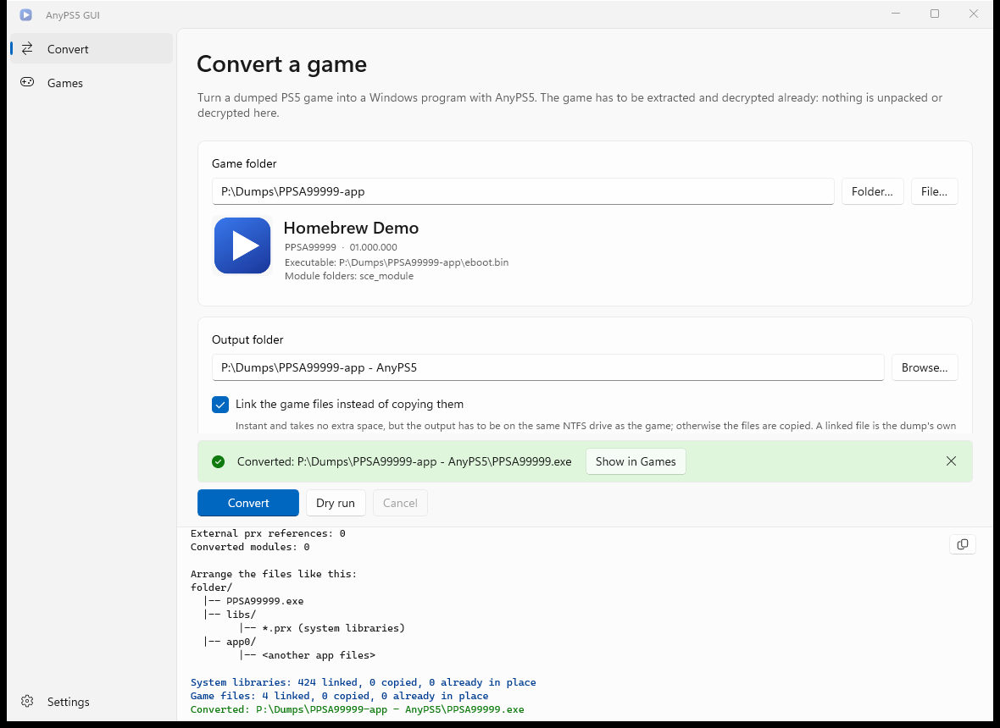
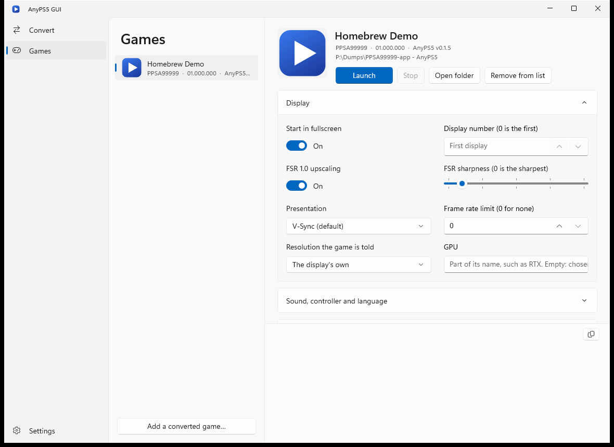

# AnyPS5 GUI

A Windows app for [AnyPS5](https://github.com/boykopovar/AnyPS5), the tool that ports PS5 executables to Windows without emulation. Instead of typing `relinker` commands and arranging folders by hand, you pick a dumped game, press **Convert**, and launch it.

AnyPS5 does the work. This app downloads it, runs it and puts the files where it expects them.



## What it does

- **Downloads AnyPS5** (the relinker and the Windows system libraries) from its GitHub releases, checks the download against the checksum GitHub lists, and lets you switch between versions.
- **Converts a game**: runs the relinker, then builds the layout a converted game needs, with `libs/` and `app0/` beside the executable.
- **Launches it** with the settings you choose (fullscreen, FSR, frame rate limit, GPU, language, volume and more) and shows what the game prints.
- **Checks the game first** and tells you in plain words when the executable is still wrapped or encrypted, or the module folder is missing.

It does not extract or decrypt anything. You need a game that is already dumped and decrypted, as AnyPS5 itself does.



## Requirements

- Windows 11 or a recent Windows 10, 64-bit. It has been tried on Windows 11.
- A CPU with AVX2, FMA, F16C, BMI1, BMI2, LZCNT and MOVBE, and a GPU with a Vulkan 1.1 driver. **Settings** shows whether your PC has them.
- A dumped, decrypted PS5 game: a folder with `eboot.bin` and, beside it, `sce_module`, `sce_modules` or `prx`.

Whether a particular game runs is up to AnyPS5. Its [game bring-up discussions](https://github.com/boykopovar/AnyPS5/discussions/categories/game-bring-up) track them one by one.

## Install

Download `AnyPS5Gui-<version>-win-x64.zip` from [Releases](../../releases), extract it anywhere and run `AnyPS5Gui.exe`. There is no installer and nothing else to install.

## Use

1. On **Convert**, press **Download** the first time. This fetches AnyPS5, about 115 MB.
2. Choose the game folder, or drop it on the window. The app shows the game it found and anything that would stop the conversion.
3. Press **Convert**. **Dry run** does the same in memory and writes nothing, which is a quick way to see whether the relinker accepts the game.
4. Press **Show in Games**, adjust how the game starts if you want, and press **Launch**.

The output goes next to the game folder, as `<game folder> - AnyPS5`, unless you choose another folder for the game or set one for all games in **Settings**.

### Linked game files

A converted game needs its files under `app0/`. By default the app hard-links them instead of copying: it is instant and takes no extra space, even for a game of tens of gigabytes. Two things follow from that:

- The output has to be on the same NTFS drive as the dump. Otherwise the files are copied.
- A linked file is the dump's own file under a second name. Editing it in one place edits it in the other. Deleting the output folder is safe and leaves the dump intact.

Untick **Link the game files instead of copying them** to always copy.

Converting a game again brings the output up to date: files that changed in the dump are replaced, the libraries become those of the AnyPS5 version in use, and your launch settings are kept.

### Options

The common relinker switches have their own controls: Intel CPUs (`--to-intel`), no console window (`--windows-gui`), and under **Advanced options** the unused-import filter, extra module folders and executables, patches, a fixed load address and the diagnostic outputs. **Extra relinker arguments** takes anything else, and **Command** shows the exact command that will run.

Launch settings are AnyPS5's environment variables. The Games page has controls for the common ones, a box for any other `NAME=VALUE`, and a preview of everything the game will be started with. The variables are described in AnyPS5's [usage guide](https://github.com/boykopovar/AnyPS5/blob/main/docs/user/USAGE.md).

### Good to know

- Closing the app stops a running game or conversion: the app reads their output through pipes that end with it.
- Every conversion, dry run and game run writes all of its output to a text file in the `logs` folder of the app's data, named after the time and the game. The window lists only the newest lines; the file has all of them and can be read while the game is running. The button beside the log opens it. The ten newest files are kept, a number you can change in **Settings**.
- Keyboard, mouse and controller mapping is AnyPS5's `anyps5-input.ini`, placed beside the converted executable. See its [input mapping guide](https://github.com/boykopovar/AnyPS5/blob/main/docs/user/INPUT_MAPPING.md).
- If you build AnyPS5 yourself, point **Settings** to your relinker and libraries folder and they are used instead of the downloaded ones.
- **Settings** also takes the name of another GitHub repository, such as a fork that publishes builds with changes AnyPS5 has not released yet. Its releases are then listed with AnyPS5's own, with the repository's name beside them, and are downloaded the same way if they carry `relinker-<tag>.exe` and `prx-windows-<tag>.zip`. A build from another repository is kept apart from AnyPS5's own, even when both carry the same version name. AnyPS5 does not review or support such builds: add only a repository you trust.
- **Download** takes AnyPS5's newest release unless you choose another from the list. Tick the box under that repository's name and it takes the release the repository marks as its latest instead, so a fork that publishes a build every day is followed without choosing each time.
- The app is in English and Spanish, and follows Windows unless you choose a language in **Settings**.

### Where things are kept

Settings, the game list, the downloaded AnyPS5 versions and the logs live in `%LOCALAPPDATA%\AnyPS5Gui`. Set the `ANYPS5GUI_DATA` environment variable to keep them in another folder, for example beside the app for a portable copy. Converted games are only ever written to the output folder you see on the Convert page.

## Security

A converted game is an ordinary Windows program. It runs with your account's permissions and has none of the console's sandbox. Convert and run only games you own and trust.

The app makes network requests only to GitHub, and only when you press **Download** or **Check for versions**: the release list of AnyPS5, that of the other repository if you added one in **Settings** and, if you ticked the box under it, its latest release, and the two files of the release you chose.

## Build

You need the [.NET 11 SDK](https://dotnet.microsoft.com/download) on Windows.

```powershell
dotnet build
dotnet test --project tests/AnyPS5Gui.Core.Tests
dotnet publish src/AnyPS5Gui -c Release -o publish/AnyPS5Gui
```

| Project | What it holds |
|---|---|
| `src/AnyPS5Gui.Core` | Everything that is not UI: relinker arguments, the conversion and its file layout, downloads, launch settings, the game list. |
| `src/AnyPS5Gui` | The WinUI 3 app (Windows App SDK), unpackaged and self-contained. |
| `tests/AnyPS5Gui.Core.Tests` | Tests for the core, and for the two language files being complete. |

Some tests convert a small executable with the real relinker and run the result. They are skipped unless `ANYPS5_RELINKER` names a `relinker.exe`:

```powershell
$env:ANYPS5_RELINKER = 'C:\path\to\relinker.exe'
dotnet test --project tests/AnyPS5Gui.Core.Tests
```

Every push is built and tested by GitHub Actions, against the newest AnyPS5 relinker. Pushing a tag `vX.Y.Z` publishes that version as a release; with a `docs/release-notes/vX.Y.Z.md` it is published at once, and without one it stays a draft.

## License

[MIT](LICENSE). AnyPS5 itself is licensed under the GPL-2.0. It is not part of this repository or of its releases: the app downloads it from AnyPS5's own releases on your PC.

This project is not affiliated with AnyPS5 or with Sony Interactive Entertainment. "PlayStation" and "PS5" are trademarks of Sony Interactive Entertainment Inc.
